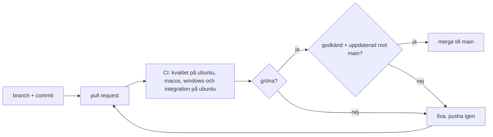

# Pipeline

## Flöde



## Jobb

CI har tre jobb i `.github/workflows/ci.yml`.

- SlopChecker2000: lint, typkontroll, tester och bygge av klienten. Körs på ubuntu, macos och windows
- Integration: API:ets integrationstester mot riktiga databaser. Körs på ubuntu
- Image: bygger Docker-avbildningarna för api, client och web. Körs på ubuntu och väntar på SlopChecker2000

Integration är oberoende av SlopChecker2000, så de två körs samtidigt.

## Steg och tider

Stegen i SlopChecker2000. Tid per steg och operativsystem i sekunder.

- Ubuntu: 25 sekunder
- macOS: 26 sekunder
- Windows: 49 sekunder

### `npm ci`

Fångar package-lock.json som inte stämmer med package.json.

- Tid på ubuntu: 10 sekunder
- Tid på macos: 11 sekunder
- Tid på windows: 19 sekunder

### `biome ci`

Fångar lintfel, varningar, felformatering, osorterat.

- Tid på ubuntu: 1 sekund
- Tid på macos: 1 sekund
- Tid på windows: 1 sekund

### `npm run lint:md`

Fångar trasig markdown i dokumenten.

- Tid på ubuntu: 0 sekunder
- Tid på macos: 1 sekund
- Tid på windows: 1 sekund

### `npm run lint:spelling`

Fångar stavfel i .js, .jsx och .md.

- Tid på ubuntu: 2 sekunder
- Tid på macos: 2 sekunder
- Tid på windows: 4 sekunder

### `npm run typecheck`

Kör först codegen, som genererar klientens typer ur `api/src/graphql/schema.js`. Fångar typfel i api och klient, och frågor som använder ett fält som inte finns i schemat.

### `npm test`

Fångar att testerna körs (ett röktest än så länge).

- Tid på ubuntu: 2 sekunder
- Tid på macos: 1 sekund
- Tid på windows: 2 sekunder

### `npm run build`

Fångar fel som bara syns när klienten byggs.

- Tid på ubuntu: 0 sekunder
- Tid på macos: 1 sekund
- Tid på windows: 2 sekunder

## Integrationsjobbet

Jobbet kör API:ets integrationstester mot riktiga databaser.

- Postgres 18 och MongoDB 8.2 startas som `services`, med hälsokontroll
- Adresserna och `JWT_SECRET` sätts som miljövariabler. Hemligheten gäller bara CI

### `npm run seed`

Fyller Postgres med testdata.

### `npm run migrate:logs`

Flyttar turloggarna till MongoDB och kontrollerar antalet dokument och mätpunkter mot Postgres. Fångar en migrering som tappar data.

### `npm run test:api`

Fångar N+1 i turlistan och saknat inloggningskrav för `createTour`. Se [testing.md](testing.md).

## Regler på main

- PR krävs, minst en godkännare och "gröna checks" från alla tre operativsystemen och från Integration
- Branchen måste vara uppdaterad mot main innan merge
- Reglerna gäller även admins

## Kommandon

```sh
npm run lint
npm run lint:md
npm run lint:spelling
npm run typecheck
npm test
npm run build
```

Integrationstesterna kräver att databaserna är igång, seedade och migrerade. Se [README](../README.md).

```sh
npm run seed
npm run migrate:logs
npm run test:api
```
